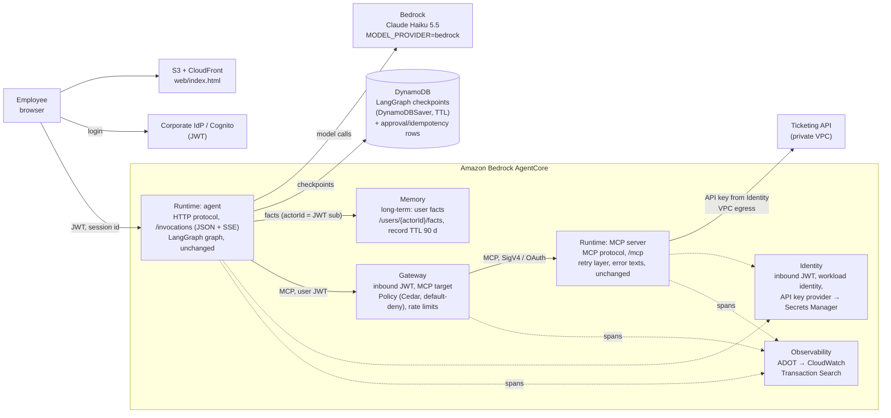

# Running this on Amazon Bedrock AgentCore

**Author:** Bohdan Velychkovych

How I would run the helpdesk agent from this repo on AWS with Amazon Bedrock AgentCore. I
haven't deployed it. The design is based on the AgentCore developer guide and release notes
as of October 2026. Where the docs don't answer something this design relies on, it is in
[What I'd verify before relying on it](#what-id-verify-before-relying-on-it).

The local build guarantees five things, and the AWS design has to keep every one:
- the agent reaches the ticketing system only through MCP
- a write runs only after the user approves it in their next message
- a pending approval survives a restart
- a write is never applied twice
- one user never sees another user's memory

## Diagram

## Which AgentCore parts I'd use and why

| Part | Used for | Why |
|---|---|---|
| **Runtime** (HTTP protocol) | The agent: the same LangGraph graph and `ChatService` | Per-session microVM isolation, scales to zero, and supports SSE on `/invocations`, which `/chat/stream` already speaks. No orchestration code to rewrite. |
| **Runtime** (MCP protocol) | The MCP server | My MCP server holds logic that Gateway's API-to-tool targets would lose: the single retry layer, the `ERROR <CODE> … Next step …` texts, and idempotency-key handling. Runtime hosts it as-is on `/mcp`. |
| **Gateway** | The only tool endpoint the agent knows. The MCP server is a Gateway MCP-server target. | It replaces "two compose networks" with a managed choke point: user JWT on every tool call, a Cedar policy engine, per-user rate limits, and one place where tool traffic shows up in traces. |
| **Identity** | Inbound: validate the employee's JWT at the agent Runtime and Gateway. Outbound: the ticketing API key | `user_id` comes from the verified JWT `sub`, not the request body. That closes the biggest limitation in the README ("any client can act as any user_id"). `MOCK_API_TOKEN` stops being an env var: it becomes an API-key credential provider backed by a Secrets Manager secret, readable only by the MCP server's workload identity. |
| **Memory** (long-term) | The four allowlisted user facts | Per-actor namespaces, encryption, and (since October 2026) record TTL fit "facts for 90 days, per user". See the trade-off below. |
| **Observability** | Traces of all three hops | ADOT is configured automatically in Runtime, and OpenInference (which I already use) is a supported instrumentation. CloudWatch Transaction Search replaces `traces/*.jsonl` and Jaeger. |
| **Policy** | Default-deny Cedar rules on Gateway tool calls | A second guardrail outside the model and outside my code. For example, only authenticated employees may call the write tools, and (if Cedar can express it) only with `reporter_id` equal to their own `sub`. |

**What I'd not use, and why:**
- **AgentCore Memory as the checkpointer** (`AgentCoreMemorySaver`). The checkpoint holds the
  pending approval and its idempotency key, which is the one piece of state that must be
  exactly right. I'd rather keep it in DynamoDB through `DynamoDBSaver`, where I understand the
  consistency model and can add conditional writes (see "Where it gets difficult"). It also
  gives the 30-day conversation TTL that the local build never enforced, and offloads
  checkpoints over 350 KB to S3. `AgentCoreMemorySaver` is the more native choice, and I'd test
  it before ruling it out.
- **Memory's extraction strategies** (semantic, user preference, summary, episodic). They
  extract facts from conversation asynchronously. My README explains why facts are a fixed
  allowlist written by an explicit `remember_fact` call: free-form extraction would turn text
  a user typed once into a standing instruction in the prompt. I'd write facts directly into a
  per-actor namespace instead.
- **AgentCore Evaluations as a replacement for `evals/`.** My safety checks read three
  services' spans and the mock's `/admin/writes`, and need a chaos switch. That only exists in a
  staging stack with the mock. I'd add Evaluations (GA since March 2026) for what my evals
  don't do: sampling production sessions online, checking tool usage and task completion,
  using the 13 cases' expected tool sequences as ground truth.
- **Code Interpreter, Browser, Harness.** Nothing in this agent needs them.

## What stays and what changes from the local build

| Concern | Local build | On AgentCore | Code change |
|---|---|---|---|
| Graph, nodes, approval flow, idempotency keys | LangGraph `StateGraph` | Same | None |
| Agent HTTP entry | FastAPI `/chat`, `/chat/stream`, any CPU architecture | Runtime contract: `POST /invocations` (JSON or SSE) and `GET /ping` on port 8080, **ARM64** image | Two thin routes that call the existing `ChatService`; build `linux/arm64` |
| Who the user is | `user_id` in the request body | Verified JWT `sub` | Read the user id from the validated token; drop it from the body |
| Thread / session | `user_id:session_id` → SQLite thread | Same thread id. Runtime session id = a deterministic 33+ character id derived from it, so one conversation sticks to one microVM | Small |
| Conversation + pending approval | `AsyncSqliteSaver`, `data/checkpoints.sqlite` | `DynamoDBSaver` (`langgraph-checkpoint-aws`), TTL 30 days, S3 offload | Swap the checkpointer in `persistence.py`; keep the strict deserialisation allowlist |
| Per-thread serialisation | In-process `asyncio.Lock` | Same lock for the common case, **plus** a DynamoDB conditional write so an `action_id` can be approved only once across processes | New, small |
| User facts | LangGraph Store, SQLite, 90-day TTL | AgentCore Memory, namespace `/users/{actorId}/facts/`, record TTL 90 days, `actorId` = JWT `sub`. Fallback: a DynamoDB table with the same key layout | Store adapter in `memory.py` |
| Tool server | `mcp` container, FastMCP on port 8001 | Runtime, MCP protocol (port 8000, `/mcp`), behind Gateway | Gateway prefixes tool names (`<target>___search_tickets`), so the agent's read/write name sets and the schema snapshot have to strip it |
| Mock credential | `MOCK_API_TOKEN` env var | Identity API-key provider → Secrets Manager | Fetch the key through Identity in `mock_client.py` |
| "Agent only via MCP" | Two compose networks, tested in e2e | Agent Runtime has no VPC route to the ticketing API, and its IAM role has no access to the secret. The MCP Runtime accepts calls only from Gateway (resource policy on `aws:SourceArn`). The MCP Runtime reaches the ticketing API through VPC egress. | Infra only; rewrite the isolation test as an IAM/network check |
| Model | Claude API, `claude-haiku-5-5` | Claude Haiku 5.5 on Bedrock, `MODEL_PROVIDER=bedrock` (`ChatAnthropicBedrock`, keeps prompt caching) | Config only |
| Traces | OTel → `traces/*.jsonl`, optional Jaeger | ADOT → CloudWatch (Transaction Search); OpenInference kept; my redaction span processor kept | Drop the JSONL exporter; `make trace` becomes a CloudWatch query |
| Web page | Served by the agent | S3 + CloudFront, login through the IdP, calls the agent Runtime with the user's JWT | Small |
| Evals | `make eval` against `agent-eval` + local mock | Same runner in CI against a staging Runtime + the mock (chaos switch included); spans read from CloudWatch instead of JSONL | Change the evidence reader in `evals/traces.py` |

## Where it gets difficult

1. **"Never write twice" against a real ticketing system.** Today the mock enforces my
   idempotency key in the same transaction as the write. A real system (ServiceNow, Jira) may
   not accept an idempotency key at all. Then the MCP server has to provide it:
   - record `key → pending` in DynamoDB with a conditional put before calling the API
   - store the created ticket id against the key after the call
   - after an unknown outcome (timeout, 5xx), search the ticketing system for the key, stored
     in a correlation field on the ticket, before trying again

   This is the part I'd design most carefully, because it is where real duplicates come from.

2. **Identity across four hops.** For the ticketing API to see *the employee* rather than a
   service account, the user's identity has to travel browser → agent Runtime → Gateway → MCP
   Runtime → ticketing API:
   - The agent must forward the user's JWT to Gateway. Runtime now passes custom headers
     through, including `Authorization`.
   - For MCP-server targets, the only documented way to carry the user downstream is OAuth
     token exchange (on-behalf-of). Token passthrough isn't supported for that target type.
   - The docs also say AgentCore does **not** enforce session-to-user mapping, so my backend
     must keep binding the thread id to the verified `sub`, as the local build does.

3. **Approval state when the process is not one process.** Locally, one process and one
   `asyncio.Lock` per thread make "approve once" hold.
   - On Runtime, the same session id is routed to the same microVM, but the docs say nothing
     about two concurrent invocations of one session.
   - A microVM stops after 15 idle minutes (the default), and an employee may approve an hour
     later on a fresh microVM. That's fine for correctness, because the checkpoint is in
     DynamoDB, but the lock is gone. Hence the conditional write on `action_id`.
   - The first request after a stop pays a cold start.

4. **Nested timeouts gain hops.** My deadlines nest on purpose: tool 15 s < agent's MCP client
   20 s < turn 90 s. Gateway and the Runtime invocation add their own timeouts in between. If
   Gateway cuts an MCP call at, say, 10 s, the model sees a transport error instead of my
   `TIMEOUT` text with its "may or may not have been applied" instruction.

5. **Keeping one trace id.** Locally I open a new MCP session per tool call so that the trace
   context reaches the mock. With Gateway in the middle (which now has its own MCP sessions),
   that workaround may no longer be needed, or may no longer work. It depends on whether
   Gateway forwards `traceparent` to the target.

6. **Evals move from files to a service.** The eval checks are deterministic because they
   read every span right after a run. In CloudWatch, spans arrive with a delay, so the runner
   needs to poll for completeness before scoring, or it will report false "not exercised"
   runs.

7. **Tool-name prefixes.** Gateway exposes `helpdesk___create_ticket`, not `create_ticket`.
   My code routes on exact names (which calls are writes, which args are injected, the schema
   snapshot). Missing one place means a write is treated as an unknown tool, or worse, as a
   read. I'd normalise the names once in the MCP provider and keep a test for it.

## What I'd verify before relying on it

I'd check these in the docs or in a small spike before committing to the design:

- [ ] **Concurrent invocations of one runtime session.** Are they serialised, rejected or run
      in parallel? This decides how much of the DynamoDB lock is needed.
- [ ] **Invocation limits.** Maximum duration of one `/invocations` call and of an SSE stream,
      checked against my 90 s turn deadline. The API reference documents a 100 MB payload and
      33–256 character session ids, but not a timeout.
- [ ] **Gateway → MCP target timeout,** and whether it can be raised above my 20 s client
      timeout.
- [ ] **Trace propagation through Gateway.** Does `traceparent` reach the MCP Runtime, so
      agent, Gateway and MCP spans share one trace id in Transaction Search?
- [ ] **Cedar expressiveness.** Can a policy compare a tool input (`context.input.reporter_id`)
      with a JWT claim of the principal? The docs show each separately, not compared. If not,
      the user id stays injected by the agent, as today.
- [ ] **AgentCore Memory for an exact-key allowlist.** Can I write a record directly into
      `/users/{actorId}/facts/` and read it back by key, not only by semantic search? Is there
      read-after-write consistency, and an IAM condition that pins a caller to its own
      `actorId`? If any answer is no, facts go to DynamoDB.
- [ ] **`DynamoDBSaver` with my graph.** The async API, my strict checkpoint deserialisation
      allowlist, and checkpoint size with a full message history (S3 offload over 350 KB).
- [ ] **Claude Haiku 5.5 on Bedrock** in the target region: the model or inference-profile id,
      and prompt-caching support through `ChatAnthropicBedrock`.
- [ ] **Browser → Runtime directly with a JWT** (CORS and token audience), or whether a thin
      API in front is needed.
- [ ] **On-behalf-of token exchange** with the corporate IdP and the ticketing system's OAuth.
- [ ] **Pricing.** Runtime bills active compute per session. Check that idle sessions and the
      `HealthyBusy` ping behaviour don't keep microVMs alive longer than needed.

## Sources

AgentCore developer guide (checked 19 October 2026):
- [Runtime sessions](https://docs.aws.amazon.com/bedrock-agentcore/latest/devguide/runtime-sessions.html) and [lifecycle settings](https://docs.aws.amazon.com/bedrock-agentcore/latest/devguide/runtime-lifecycle-settings.html)
- [Runtime HTTP protocol contract](https://docs.aws.amazon.com/bedrock-agentcore/latest/devguide/runtime-http-protocol-contract.html) and [MCP protocol contract](https://docs.aws.amazon.com/bedrock-agentcore/latest/devguide/runtime-mcp-protocol-contract.html)
- [InvokeAgentRuntime API](https://docs.aws.amazon.com/bedrock-agentcore/latest/APIReference/API_InvokeAgentRuntime.html)
- [Gateway outbound authorization](https://docs.aws.amazon.com/bedrock-agentcore/latest/devguide/gateway-outbound-auth.html) and [tool naming](https://docs.aws.amazon.com/bedrock-agentcore/latest/devguide/gateway-tool-naming.html)
- [Policy core concepts](https://docs.aws.amazon.com/bedrock-agentcore/latest/devguide/policy-core-concepts.html) and [conditions](https://docs.aws.amazon.com/bedrock-agentcore/latest/devguide/policy-conditions.html)
- [Memory with LangGraph](https://docs.aws.amazon.com/bedrock-agentcore/latest/devguide/memory-integrate-lang.html) and [creating a memory](https://docs.aws.amazon.com/bedrock-agentcore/latest/devguide/memory-create-a-memory-store.html)
- [Observability configuration](https://docs.aws.amazon.com/bedrock-agentcore/latest/devguide/observability-configure.html)
- [Release notes](https://docs.aws.amazon.com/bedrock-agentcore/latest/devguide/release-notes.html): Policy GA and Evaluations GA (March 2026), VPC egress and on-behalf-of token exchange (April 2026), Gateway MCP sessions and custom header passthrough (May 2026), Gateway Runtime targets and gateway-only inbound enforcement (July 2026), memory record TTL (October 2026)
- [DynamoDB LangGraph checkpointer](https://docs.aws.amazon.com/amazondynamodb/latest/developerguide/ddb-langgraph-checkpoint.html)
