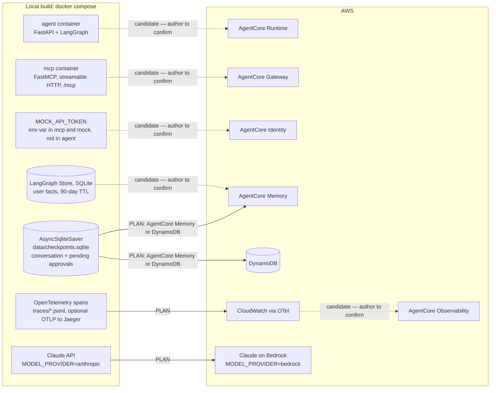

# Running this on Amazon Bedrock AgentCore

<!-- HUMAN: write this -->

## Which AgentCore components and why

<!-- HUMAN: write this -->

Components to cover (PLAN.md): Runtime, Gateway, Identity, Memory, Observability.

## What stays and what changes from the local build

<!-- HUMAN: write this -->

Local build inventory (facts). The right-hand column lists the candidates named in
PLAN.md; the author decides.

| Concern | Local build | Candidate named in PLAN.md |
|---|---|---|
| Agent process | `agent` container, FastAPI + LangGraph, `python -m helpdesk.agent` | <!-- HUMAN --> |
| Tool server | `mcp` container, FastMCP streamable HTTP at `/mcp` | <!-- HUMAN --> |
| Mock credential | `MOCK_API_TOKEN` env var in `mcp` (sends it) and `mock` (checks it); never in `agent` | <!-- HUMAN --> |
| Conversation state + pending approvals | `AsyncSqliteSaver`, `data/checkpoints.sqlite` | AgentCore Memory or DynamoDB |
| User facts | LangGraph Store (SQLite), namespace `("users", user_id, "facts")`, 90-day TTL | <!-- HUMAN --> |
| Traces | OpenTelemetry → `traces/*.jsonl`, optional OTLP → Jaeger | CloudWatch via OTel |
| Model | Claude API (`MODEL_PROVIDER=anthropic`, `claude-sonnet-5-5`) | Claude on Bedrock (`MODEL_PROVIDER=bedrock`) |
| Network isolation | Two compose networks; agent has no route to the mock | <!-- HUMAN --> |

## Where it gets difficult

<!-- HUMAN: write this -->

## Diagram

<!-- HUMAN: write this -->

<!-- generated (Phase 3, Track G) from PLAN.md §0, §1, §4 Phase 0 step 7 and the local build (docker-compose.yml, Settings) -->

- Solid edges: mappings PLAN.md names explicitly (§4 Phase 0 step 7):
  - SQLite checkpointer (with pending approvals) → AgentCore Memory or DynamoDB
  - JSONL traces → CloudWatch via OTel
  - Claude API → Claude on Bedrock (`MODEL_PROVIDER=bedrock`, `ChatAnthropicBedrock`;
    CONTRACTS §7)
- Dashed edges: candidates PLAN.md does not name; the author confirms or removes each one.
- Component set (PLAN.md): Runtime, Gateway, Identity, Memory, Observability.
- Not drawn: network isolation (two compose networks); PLAN.md names no target for it.

## What I'd verify in the AWS docs before relying on it

<!-- HUMAN: write this -->
